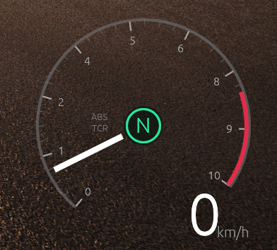
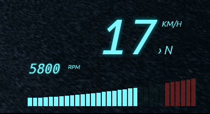

# Custom HUD (custom_hud)

HUDs drawn by CXSFM on top of the game, described in a TOML file and
**hot-reloaded**: save the file, the result shows up in game within
~1 s. Cosmetic only: the mod **reads** game values, it never writes
anything into the game.

- File: `~/.config/cxsfm/custom_hud.toml` (created with an example the first
  time the **Custom HUD** tile is enabled).
- Mod window (menu open): file path, active HUDs, config errors and
  warnings, live values, and the **Explorer** tab to find new values.
- HUDs stay visible with the menu closed and never take the mouse or
  the keyboard.

## 1. File layout

```toml
version = 2
fps = 30          # HUD refresh rate (5..60)
mode = "live"     # "live" = game values, "demo" = animated fake values

[sources]         # game values, by name (see §3)
speed = "UITachometer/m_currentSpeed"

[[hud]]           # as many [[hud]] as you like
name = "My HUD"
  [[hud.widget]]  # the HUD's elements, drawn in order
  type = "text"
  text = "{speed}"
```

A TOML **syntax** error keeps the last valid config on screen (the
error is shown in the mod window). An invalid key or widget is only
**skipped**, with a warning.

`mode = "demo"` is for layout work without driving: it animates
`speed`, `gear`, `max_gear`, `rpm`, `rpm_min`, `rpm_max` and `redline`
in the same units as the game.

## 2. Positions, sizes, angles

Each `[[hud]]` is a **box** placed on the screen:

| Key | Role | Default |
|---|---|---|
| `enabled` | show this HUD | `true` |
| `anchor` | screen corner/edge: `top_left`, `top`, `top_right`, `left`, `center`, `right`, `bottom_left`, `bottom`, `bottom_right` | `bottom_right` |
| `offset` | `[x, y]` shift in pixels from the anchor | `[0, 0]` |
| `size` | box size `[w, h]` (before `scale`) | `[300, 100]` |
| `scale` | zoom of the whole HUD | `1.0` |
| `opacity` | opacity of the whole HUD | `1.0` |
| `background` | box background | transparent |
| `hide_when_missing` | hide the HUD while no value is read (menus, loading) | `true` |

The box corner matching the anchor sits on that screen corner, then
`offset` moves it (`offset = [-48, -48]` with `bottom_right` = 48 px
from the bottom-right edge).

**Inside the box**, each widget is placed with `pos = [x, y]` (pixels,
origin at the box's top-left, multiplied by `scale`). A widget may
**overflow** the box (negative `pos`, or larger than `size`): the box
is a reference frame, not a clip.

**Angles** (arcs, needle, ticks, `rotation` of every widget): in
**degrees**, **0 = up**, **clockwise**. `90` = right, `180` = down,
`-90` = left.

**Every widget** accepts `pos`, `rotation` and `opacity` (`0.0..1.0`,
multiplied by the HUD opacity), plus `alert` + `alert_color` (shared
colour, see §3b).

## 3. Sources: bind a game value

```toml
[sources]
speed    = "UITachometer/m_currentSpeed"
gear     = "UITachometer/m_gear"
max_gear = "UITachometer/m_maxGears"
rpm      = "UITachometer/m_rpmFillImage/m_FillAmount"
rpm_min  = "UITachometer/m_minRpmFillAmount"
rpm_max  = "UITachometer/m_maxRpmFillAmount"
# red zone measured from the far end of the dial → 1 - value
redline  = { path = "UITachometer/m_rpmRedZoneImage/m_FillAmount", scale = -1.0, offset = 1.0 }
# DERIVED sources: rev-count illusion in rpm (see "Rev-count illusion")
rpm_tr    = { from = "rpm", in = ["rpm_min", "redline"], out = [0, 7000], clamp = false, round = 50 }
rpm_max_k = { from = "rpm_max", in = ["rpm_min", "redline"], out = [0, 7], clamp = false }
```

- Short form: `name = "Class/reference/…/field"`.
- Long form: `name = { path = "…", scale = 1.0, offset = 0.0 }` →
  displayed value = `value × scale + offset` (invert, convert a unit,
  shift a gear index…).
- `speed_mph` always exists too (derived from `speed` in km/h).
- **Text sources**: when the path ends on a `string` field (a label of
  the game's interface, e.g. a TMP text's `m_text`), the source holds
  that text (at most 512 characters). Show it with `{name}` in a `text`
  or `label` widget; `scale`/`offset` do not apply to it, and it cannot
  drive bars, arcs, needles or states.
  `m_currentSpeed` already follows the unit chosen in the game.
- **Finding a path**: **Explorer** tab → search a class (e.g.
  `Tachometer`) → click it → its fields show with their values; `→`
  follows a reference; **Reread** after driving to see what moves;
  **hover a field** to read its path.
- The game's RPM is not in rpm: it is the dial's **fill amount**
  (`rpm`), between `rpm_min` and `rpm_max`. Give those two sources as
  widget bounds (see below) and the dial follows each car's own range.

### Derived sources (conversion)

```toml
name = { from = "source", in = [a, b], out = [c, d], clamp = true, round = 0 }
```

Linearly converts `source` from the `[a, b]` range to `[c, d]`. The 4
bounds are numbers **or** sources, and a derived source may use
another one (order does not matter).

| Key | Role | Default |
|---|---|---|
| `from` | converted source | — |
| `in`, `out` | ranges `[a, b]` → `[c, d]` | — |
| `clamp` | `true`: result kept inside `[c, d]`; `false`: the line keeps going past it | `true` |
| `round` | snap to a multiple (e.g. `50` → 7813 becomes 7800); `0` = none | `0` |

#### Rev-count illusion (the game's real RPM is not readable)

The game only exposes its dial **fill** (`rpm`, between `rpm_min` and
`rpm_max`) and the position of its **red zone** (`redline`, same
unit). The game places the red zone **per car**: we use it as an
anchor by giving it a plausible rev-limiter value, and everything else
follows proportionally.

```toml
rpm_tr    = { from = "rpm", in = ["rpm_min", "redline"], out = [0, 7000], clamp = false, round = 50 }
rpm_max_k = { from = "rpm_max", in = ["rpm_min", "redline"], out = [0, 7], clamp = false }
```

- `rpm_tr`: 0 rpm at the dial's idle, **exactly 7000 where the red
  zone starts**, and it keeps going (`clamp = false`) to the end of the
  dial; snapped to 50 like a digital tach.
- `rpm_max_k`: the end of the dial in **thousands**, per car (e.g.
  8.0) — plug it into an automatic dial: `type = "ticks"`,
  `count = "auto"`, `label_max = "rpm_max_k"`.
- Change `7000` / `7` (together) for the limiter you want to show.

This is **not** the real RPM: it is a consistent scale (the limiter
always lands on the game's red zone, cars with a late red zone rev
higher). It is only right if `redline` is calibrated: at the limiter,
`{rpm_tr}` should read ~7000.

### `min` / `max` / `redline` bounds

Wherever a widget accepts `min`, `max`, `redline`, you can put **a
number** (`max = 8000`) **or a source name** (`max = "rpm_max"`). A
widget whose source or bound is missing is not drawn.

## 3b. States and shared colour (`[states]`, `alert`)

A **state** is a named condition, evaluated once per frame and usable
by as many widgets as you like. Example: everything turns red while
the revs are in the red zone.

```toml
[states]
red     = { source = "rpm", above = "redline" }             # rpm ≥ redline
shift   = { source = "rpm", above = "redline", blink = 6 }  # same, blinks 6×/s
slow    = { source = "speed", below = 30 }                  # speed ≤ 30
band    = { source = "speed", above = 80, below = 120 }     # 80 ≤ speed ≤ 120
neutral = { source = "gear", below = 0.5, above = -0.5 }    # gear N
```

| Key | Role | Default |
|---|---|---|
| `source` | tested value (required) | — |
| `above` | active while value **≥** this number or source | none |
| `below` | active while value **≤** this number or source | none |
| `blink` | blink rate in Hz (`0` = steady) | `0` |

Without `above` or `below`, the state is active while the value is not 0.

Then, on **any widget**:

```toml
  [[hud.widget]]
  type = "text"
  text = "{speed}"
  alert = "red"            # name of a [states] entry
  alert_color = "#E03030"  # colour while the state is active (default: red)
```

The widget's **main** colour changes: bar or arc fill, needle, text;
for `ticks`, marks **and** labels. Backgrounds (`track_color`) and
`redline_color` keep their role. An unknown state name is reported in
the warnings.

## 4. Widgets

### `bar` — horizontal bar

| Key | Role | Default |
|---|---|---|
| `source` | displayed value (required) | — |
| `min`, `max` | bounds (number or source) | `0`, `1` |
| `redline` | from this value on, the bar turns `redline_color`; the zone is hinted dimly on the track | none |
| `pos`, `size` | top-left corner, `[length, thickness]` | `[0,0]`, `[200,8]` |
| `segments` | `0` = continuous, else number of blocks | `0` |
| `fill` | `"left"` (from the left) or `"right"` (from the right up to the value) | `"left"` |
| `rotation` | rotation around `pos` (`90` = vertical bar going down, `-90` = going up) | `0` |
| `taper` | segmented bars: `[first, last]` segment height as a fraction of `size` (bottom-aligned ramp, e.g. `[0.3, 1.0]`) | none |
| `taper_curve` | ramp shape: `1` = straight, `> 1` = flat then steep, `< 1` = the opposite | `1` |
| `color`, `redline_color`, `track_color` | fill, red zone, track | white, red, white 16 % |

### `arc` — circle, half circle, arc, disc, pie

| Key | Role | Default |
|---|---|---|
| `pos` | **centre** | `[50, 50]` |
| `radius`, `thickness` | radius, ring width | `50`, `6` |
| `start`, `end` | start/end angles (`0→360` = full circle, `-90→90` = top half, `90→270` = bottom half) | `-135`, `135` |
| `rotation` | shifts `start` and `end` | `0` |
| `filled` | `true` = disc / filled slice instead of a ring | `false` |
| `color`, `track_color` | colour (static or fill), arc track | white, white 16 % |
| `source`, `min`, `max`, `redline`, `redline_color` | optional: the arc fills with the value, like a bar | static |
| `fill` | `"start"` (from `start`) or `"end"` (from `end` back to the value) | `"start"` |

Without `source`, it is a static shape in `color` (decoration, dial, dot).

### `needle`

| Key | Role | Default |
|---|---|---|
| `source`, `min`, `max` | value and bounds (`source` required) | —, `0`, `1` |
| `pos` | rotation centre | `[50, 50]` |
| `start`, `end` | angle for `min` and for `max` | `-135`, `135` |
| `rotation` | shifts `start`/`end` | `0` |
| `length` | tip radius | `50` |
| `inner` | radius where the needle starts (leaves a hole in the middle) | `0` |
| `tail` | tail behind the centre | `0` |
| `width` | thickness | `3` |
| `color`, `redline`, `redline_color` | colour, turns red at `redline` | white, none, red |

### `ticks` — dial graduations and numbers

| Key | Role | Default |
|---|---|---|
| `pos`, `radius` | centre, outer radius of the marks | `[50,50]`, `50` |
| `start`, `end`, `rotation` | as for `arc` | `-135`, `135`, `0` |
| `count` | number of major intervals (`8` → 9 major marks), or `"auto"` = one major mark per label unit | `8` |
| `minor` | subdivisions per interval (`4` → 3 small marks between two majors) | `4` |
| `major_length`, `minor_length` | mark length (inwards) | `10`, `5` |
| `major_width`, `minor_width` | thickness | `2`, `1` |
| `color`, `minor_color` | major / minor mark colour | white 63 % |
| `labels` | numbers at the major marks | `true` |
| `label_min`, `label_max`, `label_decimals` | numbers from `label_min` to `label_max`; `label_max` = number **or source** | `0`, `count`, `0` |
| `label_margin` | added to `label_max` (headroom past the max) | `0` |
| `label_radius` | radius of the numbers | under the marks |
| `label_size`, `label_color` | size, colour | `14`, white 63 % |

Numbers stay upright (readable); only their positions follow the circle.

**Per-car automatic dial**: with a source giving the max RPM in
thousands, the dial adapts by itself (7000 rpm + margin 2 → numbers 0
to 9, 9 intervals):

```toml
[sources]
max_rpm_k = { path = "Class/…/max_rpm_field", scale = 0.001 }

  [[hud.widget]]
  type = "ticks"
  count = "auto"
  label_max = "max_rpm_k"
  label_margin = 2
```

The max-RPM path has to be found with the Explorer (the current
`rpm*` sources are fill amounts, not rpm) — or use `rpm_max_k` from
the rev-count illusion above. If the source is missing, the widget is
not drawn.

### `text` — text and values

| Key | Role | Default |
|---|---|---|
| `text` | text, with `{name}` values | `""` |
| `pos` | alignment point (top of the text) | `[0, 0]` |
| `size` | size | `16` |
| `align` | `"left"`, `"center"`, `"right"` (relative to `pos`) | `"left"` |
| `mono` | fixed-width font (digits that do not "dance") | `false` |
| `rotation` | rotation around `pos` | `0` |
| `skew` | italic-like lean, in degrees (`12` = leaning right) | `0` |
| `glow` | glow around the text, radius in px (`0` = none) | `0` |
| `glow_color` | glow colour — keep a low alpha (e.g. `"#00E5FF22"`), it is stacked 16 times | `color` at 12 % |
| `color` | colour | white |

Values in the text:

- `{name}` → the source, no decimals (`{speed}` → `139`);
- `{name:2}` → with 2 decimals (`{rpm:2}` → `0.46`);
- `{gear}` → `R`, `N`, `1`, `2`… (`{gear:0}` gives the raw number);
- `{speed_mph}` → speed converted to mph;
- an unknown name is shown as is (`{boost}`): a typo is visible right
  away.

egui has no italic font: `skew` leans the glyphs themselves, which
gives the same look.

### `label` — full text widget (text sources, limits, fonts)

Everything `text` does, plus what game interface strings need: limits
on the number of characters, font family, bold, outline, background,
letter spacing, wrapping.

```toml
  [[hud.widget]]
  type = "label"
  source = "track"         # = text = "{track}" (text or number source)
  pos = [0.0, 0.0]
  size = 22
  font = "serif"           # sans | mono | serif | title
  bold = true
  max_chars = 16           # keep 16 characters…
  keep = "start"           # …from the start ("end" = the last ones)
  ellipsis = "…"           # added where the text was cut
  case = "upper"           # keep | upper | lower
  outline = 2
  background = "#00000080"
  padding = [8, 4]
  corner = 4
```

| Key | Role | Default |
|---|---|---|
| `text` | text with `{name}` (numbers and **text sources**) | `""` |
| `source` | shorthand for `text = "{source}"` | none |
| `skip_start`, `skip_end` | characters dropped at the start / end first (fixed prefix, unit…) | `0`, `0` |
| `max_chars` | then at most this many characters (`0` = no limit) | `0` |
| `keep` | `"start"` keeps the first characters, `"end"` the last ones | `"start"` |
| `ellipsis` | marker put on the cut side when the text was cut (`""` = none) | `"…"` |
| `case` | `"keep"`, `"upper"`, `"lower"` | `"keep"` |
| `trim` | remove spaces / line breaks around the text | `true` |
| `strip_tags` | remove the game's rich-text tags (`<color=…>`, `<b>`…) | `true` |
| `font` | `"sans"` (Rajdhani), `"mono"` (fixed width), `"serif"` (PT Serif), `"title"` (Bebas Neue, capitals) | `"sans"` |
| `bold` | thicker glyphs | `false` |
| `size`, `color`, `align`, `pos`, `rotation`, `skew`, `opacity` | as for `text` | `16`, white, `"left"`, `[0,0]`, `0`, `0`, `1` |
| `letter_spacing` | extra space between letters, px | `0` |
| `max_width` | wrap onto several lines past this width (`0` = one line) | `0` |
| `line_height` | line height when wrapping | font's |
| `outline`, `outline_color` | contour around the letters, px | `0`, black |
| `glow`, `glow_color` | halo, as for `text` | `0` |
| `background`, `padding`, `corner` | box behind the text (turns with `rotation`), its margin `[x, y]` and corner radius | none, `[4, 2]`, `0` |

Order of the limits: tags removed → spaces trimmed → `skip_start` /
`skip_end` → `max_chars` (+ `ellipsis`) → `case`. An empty result
draws nothing (no background either). `bold` is drawn by thickening
the glyphs (the fonts have no bold file).

## 5. Full example: needle speedometer



Dial graduated 0 → 8, red zone at the end of travel, needle, gear in a
green circle in the middle, big speed bottom-right. Paste this
`[[hud]]` into your file (with the `[sources]` from §3), set the other
HUD to `enabled = false` if needed, save.

```toml
[[hud]]
name = "preview_FH"
enabled = true
anchor = "bottom_right"
offset = [-40.0, -40.0]
size = [380.0, 340.0]

  # thin dial line
  [[hud.widget]]
  type = "arc"
  pos = [170.0, 170.0]
  radius = 150
  thickness = 2
  start = -140
  end = 125
  color = "#FFFFFF50"

  # graduations + numbers 0..8
  [[hud.widget]]
  type = "ticks"
  pos = [170.0, 170.0]
  radius = 148
  start = -140
  end = 125
  count = 8
  minor = 4
  major_length = 12
  minor_length = 6
  label_min = 0
  label_max = 8
  label_size = 16
  color = "#FFFFFFA0"
  minor_color = "#FFFFFF50"
  label_color = "#FFFFFFA0"

  # red zone: from the redline to the end of the dial
  [[hud.widget]]
  type = "arc"
  source = "redline"
  min = "rpm_min"
  max = "rpm_max"
  fill = "end"
  pos = [170.0, 170.0]
  radius = 146
  thickness = 6
  start = -140
  end = 125
  color = "#E0304A"
  track_color = "#00000000"

  # needle
  [[hud.widget]]
  type = "needle"
  source = "rpm"
  min = "rpm_min"
  max = "rpm_max"
  redline = "redline"
  pos = [170.0, 170.0]
  start = -140
  end = 125
  inner = 34
  length = 140
  width = 4
  color = "#FFFFFF"
  redline_color = "#E0304A"

  # centre circle: dark fill + green ring
  [[hud.widget]]
  type = "arc"
  pos = [170.0, 170.0]
  radius = 28
  start = 0
  end = 360
  filled = true
  color = "#14201CD0"

  [[hud.widget]]
  type = "arc"
  pos = [170.0, 170.0]
  radius = 22
  thickness = 3
  start = 0
  end = 360
  color = "#2EE59D"

  # gear in the middle
  [[hud.widget]]
  type = "text"
  text = "{gear}"
  pos = [170.0, 150.0]
  size = 30
  align = "center"
  color = "#2EE59D"

  # labels
  [[hud.widget]]
  type = "text"
  text = "ABS"
  pos = [108.0, 150.0]
  size = 13
  align = "center"
  color = "#FFFFFF70"

  [[hud.widget]]
  type = "text"
  text = "TCR"
  pos = [108.0, 166.0]
  size = 13
  align = "center"
  color = "#FFFFFF70"

  [[hud.widget]]
  type = "text"
  text = "km/h"
  pos = [372.0, 228.0]
  size = 16
  align = "right"
  color = "#FFFFFF90"

  # big speed, slightly tilted
  [[hud.widget]]
  type = "text"
  text = "{speed}"
  pos = [376.0, 246.0]
  size = 84
  align = "right"
  rotation = -4
```

To tweak it: the whole dial shares `pos = [170, 170]` and the same
`start`/`end` — change them together to move or open up the dial; the
`[[hud]]` `scale` enlarges everything.

## 5b. Example: digital cluster (LCD style)



Big leaning speed with a cyan glow, `KM/H`, gear, rev count in digits
and a ramp of segments lighting up with the revs. Uses `rpm_tr` (the
derived source from §3).

```toml
[[hud]]
name = "NFS_Word"
enabled = true
anchor = "bottom_right"
offset = [-40.0, -40.0]
size = [360.0, 200.0]

  # speed
  [[hud.widget]]
  type = "text"
  text = "{speed}"
  pos = [250.0, 0.0]
  size = 96
  align = "right"
  mono = true
  skew = 12
  glow = 6
  color = "#7FF6FF"
  glow_color = "#00E5FF22"

  [[hud.widget]]
  type = "text"
  text = "KM/H"
  pos = [262.0, 18.0]
  size = 16
  skew = 12
  color = "#7FF6FF"

  # gear
  [[hud.widget]]
  type = "text"
  text = "› {gear}"
  pos = [262.0, 66.0]
  size = 24
  skew = 12
  color = "#7FF6FF"

  # rev count in digits
  [[hud.widget]]
  type = "text"
  text = "{rpm_tr}"
  pos = [0.0, 104.0]
  size = 26
  mono = true
  skew = 12
  glow = 3
  color = "#7FF6FF"
  glow_color = "#00E5FF22"

  [[hud.widget]]
  type = "text"
  text = "RPM"
  pos = [80.0, 108.0]
  size = 12
  skew = 12
  color = "#7FF6FF"

  # rev bar: 28 segments on a curved ramp
  [[hud.widget]]
  type = "bar"
  source = "rpm"
  min = "rpm_min"
  max = "rpm_max"
  redline = "redline"
  pos = [0.0, 138.0]
  size = [340.0, 56.0]
  segments = 28
  taper = [0.3, 1.0]
  taper_curve = 2.5
  color = "#7FF6FF"
  redline_color = "#FF5A5A"
  track_color = "#7FF6FF14"
```

## 6. Troubleshooting

- **Nothing shows**: mod window → the status line says `UITachometer:
  not found` when not driving (normal, retried every 5 s); otherwise
  read the config warnings.
- **"live mode without [sources]"**: add a `[sources]` section (§3),
  or delete `custom_hud.toml` to regenerate the example.
- **A value stays `{name}` on screen**: name missing from `[sources]`,
  or a typo.
- **A bar/arc/needle is missing**: its source or a bound (`min`/`max`
  as a source name) is not read — check the last line of the mod
  window, which lists every value.
- **Layout work without driving**: `mode = "demo"`.
