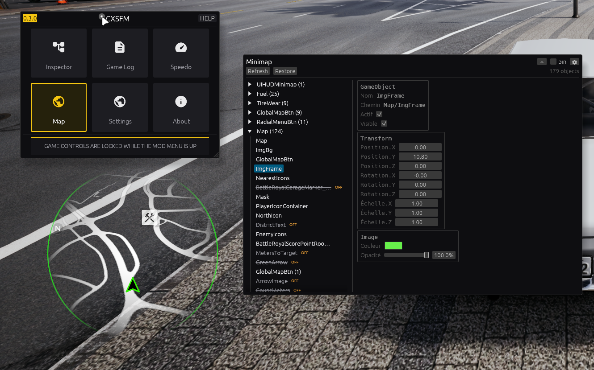

# Minimap mod (map)

Same Inspector-style interface as [speedo](../speedo/README.md),
applied to the game's minimap HUD — cosmetic only. Roots and
vocabulary come from wyr-menu v0.2 (`minhud.so` strings):
`UIHUDMinimap` → `Map/...` (`ImgFrame`, `Mask/Base/RoadImage`,
`PlayerIconContainer`, `NorthIcon`…), hide via `SetActive`, opacity
via `CanvasGroup`.

## What it does

Walks `UIHUDMinimap` and lists **everything** under it — 179 objects
in the screenshot, including sections the dashboard walk would miss:
`Fuel (25)`, `TireWear (9)`, `GlobalMapBtn`, `RadialMenuBtn`,
`Map (124)` with icons, markers, texts (inactive ones flagged `OFF`).
Move, resize, recolor, fade, hide or deactivate any of them; the
minimap bottom-left updates live.

## How to use

Identical to speedo: enable the **Map** tile, Refresh after scene
changes, edit cards in realtime, Restore (or disable) to write all
originals back. See [speedo's README](../speedo/README.md) for the
card layout, the realtime drain and the safety design — this mod
shares its data model (`speedo::model`) and behavior, only the roots
(`UIHUDMinimap`, fallback `Map`) and the tile (globe, `mod_map`)
differ.

See `docs/field-notes.md` (WYR-MENU + MINIMAP sections) for roots,
hide/opacity mechanisms and camera names reserved for the FPV future.
