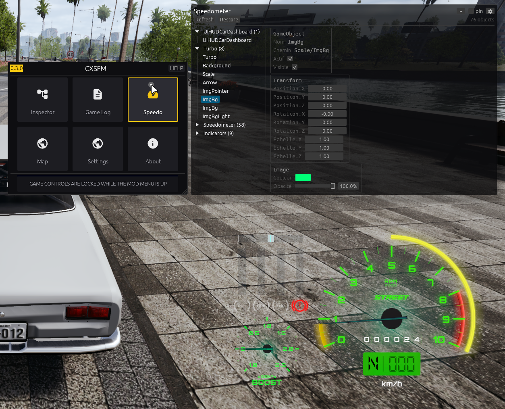

# Speedometer mod (speedo)

Inspector-style restyle of the game's speedometer HUD — cosmetic only.
No physics, no economy, no gameplay values are ever touched.

## What it does

Walks `UIHUDCarDashboard` (`Turbo`, `Speedometer`, `Nitro`, `Speed`,
`Indicators` — 76 objects in the screenshot) and lets you move,
resize, recolor, fade, hide (`Visible`) or deactivate (`Actif`) any
of them. The screenshot shows the result live: the whole cluster
recolored green through the mod.

## How to use

1. Enable the **Speedo** tile in the CXSFM menu (boots disarmed).
2. Press **Refresh** (re-discovers after a scene change).
3. Pick an object in the section tree, edit its card — changes apply
   **in realtime** (next tick, one Unity pass).
4. **Restore** (or disabling the mod) writes every first-seen original
   back: positions, scales, colors, opacities, active states.
5. **Save** writes only your modified params to
   `~/.config/cxsfm/saves.toml` (`[speedo."object/path"]` tables);
   **Load** applies them back in one pass. Hand-editable, paths only.

## Interface

- Left: section tree (`Section (n)`), painted expanders, `OFF` badge on
  inactive branches (they bind too — `Transform` children enumerate
  inactive objects, which `GameObject.Find` never sees).
- Right: `GameObject` card (name, dashboard path, `Actif` toggle,
  `Visible` scale-zero hide), `Transform` card (`Position` / `Rotation`
  / `Échelle`, local space — what the Canvas keeps), and for graphic
  leaves the `Image` / `TextMeshProUGUI` card (color, opacity via
  `CanvasGroup` when present else color alpha, TMP text preview + size).
  Pure containers stop after Transform.
- Header: Refresh, Restore, bound-object counter. Window chrome:
  pin, display options, hideable title bar / controls (see `tool.rs`).

## Safety design (proven in game)

- Explicit triggers only (arming, Refresh/Restore, staged drains) —
  an idle tick performs zero Unity calls.
- Every handle alive-checked (`m_CachedPtr`) before every invoke;
  stale addresses are re-resolved by dashboard path, never touched.
- Fallback section roots (`Speedometer`, `Tachometer`, …) when the
  dashboard itself is unmounted; two-candidate path resolve.
- `SetActive` goes through the same alive-checked single pass as
  every write (it fires game lifecycle callbacks — if a toggle ever
  crashes, suspect it first).

See `docs/field-notes.md` (Speedometer + WYR-MENU sections) for the
full findings log.
